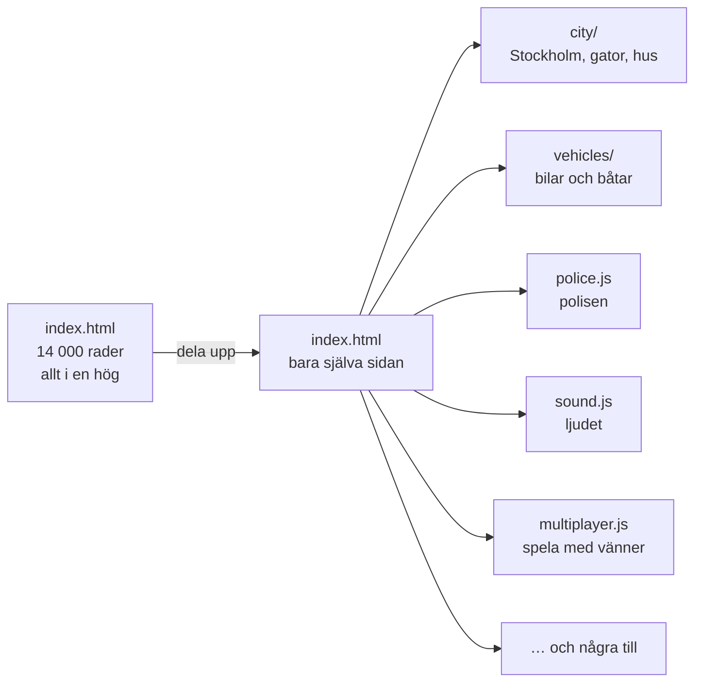
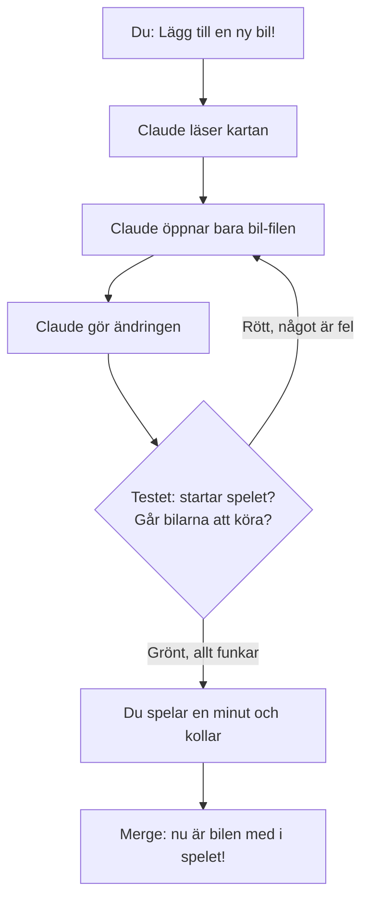
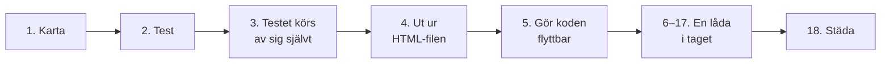

# Plan: dela upp Gubbe på Vägen

## Vad är det här, och varför?

Du har byggt ett riktigt stort spel. Hela spelet ligger i **en enda fil**, `index.html`, och den har nästan **14 000 rader** kod. Det har börjat bli ett problem.

### Problemet: Claude måste leta varje gång

Claude har ett slags korttidsminne. Det kallas **kontext**. Allt Claude läser hamnar där, och det får bara plats en viss mängd. Texten mäts i **tokens**, små ordbitar på ungefär ett halvt ord. Din fil är ungefär **300 000 tokens**. Det är för mycket för att Claude ska läsa hela filen varje gång.

Så när du skriver *"lägg till en ny polisbåt"* måste Claude först leta sig fram i filen. Det är som att leta efter en enda Lego-bit i en jättelåda där alla bitar ligger blandade. Letandet tar tid och kostar tokens. Ju större spelet blir, desto mer letande.

### Lösningen: lådor med etiketter

Riktiga programmerare gör inte så. De delar upp koden i många mindre filer, och varje fil har ett eget jobb. Det är som att sortera Lego-bitarna i lådor med etiketter: hjul i en låda, fönster i en annan.

### Tre saker vi bygger

1. **En karta** (`CLAUDE.md`). Claude läser den automatiskt i början av varje session och vet då direkt var allt finns, ungefär som en innehållsförteckning i en bok.
2. **Ett test.** Ett litet program som startar spelet, kör en bil en bit och kollar att inget gick sönder. Det körs efter varje ändring, så Claude märker själv om den har förstört något.
3. **Uppdelningen.** Koden flyttas ut i lådor, en låda i taget.

Så här kommer det att gå till när du ber Claude om något, när planen är klar:

### Vägen dit

Vi tar det i små steg. Varje steg är en **PR** (förklaras i ordlistan nedan). Spelet ska funka precis som förut efter varje steg. Vi lägger inte till några nya saker i spelet medan vi delar upp. Om något går sönder vet vi då att det var flytten som gjorde det.

### Ordlista

| Ord | Vad det betyder |
| --- | --- |
| **Kod** | Instruktionerna som säger åt datorn vad spelet ska göra. |
| **Fil** | Ett dokument med kod i. Just nu har spelet en jättefil. |
| **Kontext** | Claudes korttidsminne: allt den har läst i den här sessionen. |
| **Token** | En liten ordbit. Claude läser och betalar i tokens. |
| **PR** (pull request) | Ett paket med ändringar som du kan titta på innan det blir en del av spelet. |
| **Merga** | Att godkänna en PR så att ändringarna kommer med i spelet. |
| **Test** | Ett litet program som kollar att ett annat program funkar. |
| **Röktest** | Ett snabbt test av det viktigaste. Namnet kommer från elektriker: koppla in, och kolla att det inte ryker. |
| **GitHub Action** | En robot på GitHub som kör testet åt dig vid varje PR. |
| **`CLAUDE.md`** | Kartan. En fil som Claude läser automatiskt i varje session. |

## Så använder du planen

1. Starta en ny Claude-session för repot och skriv: **"Gör nästa PR i PLAN.md"**.
2. Claude gör jobbet och bockar av rutorna i den här filen i samma PR. Du ser hur långt ni har kommit genom att kolla vilka rutor som är ikryssade.
3. Testa spelet själv i en minut: gå, kör en bil, öppna kartan. Funkar allt? Då mergar du.
4. Kör bara **en** session åt gången på planen. Två samtidigt ändrar i samma filer och krockar.

---

> **Härifrån och nedåt är det instruktioner till Claude.** Du behöver inte förstå allt. Rutorna visar vad som är gjort.

## Regler för agenten (Claude)

- Läs `CLAUDE.md` först (när den finns) och läs aldrig hela `index.html` på en gång. Sök på sektionsrubrikerna (`/* ===== … ===== */` och `/* ----- … ----- */`).
- Gör bara rutorna i **en** PR-sektion per pull request. Bocka av dem i `PLAN.md` i samma PR.
- **Språk:** följ koden som den är. Kod, variabelnamn och kommentarer skrivs på **engelska**. All text som spelaren ser, `README.md` och commit-meddelanden skrivs på **svenska**. `CLAUDE.md` skrivs på engelska, eftersom den handlar om koden.
- Under uppdelningen flyttas koden **utan att ändras**. Det enda som får ändras är det som krävs för att den ska fungera i en egen fil. Rätta inga buggar och snygga inte till något på vägen. Skriv upp det du ser under "Saker att fixa senare" längst ner.
- Spelet ska fortfarande gå att starta genom att dubbelklicka på `index.html`. Använd därför vanliga `<script src="…">`-taggar, **inte** ES-moduler (`type="module"`, `import`/`export`). Ingen build-steg.
- Behåll kodens ursprungliga ordning när den delas upp. Filerna laddas uppifrån och ned i `index.html` i samma ordning som koden låg i den stora filen. Då kommer allt som körs direkt när en fil laddas att finnas redan.
- Röktestet ska vara grönt innan PR:en öppnas (från PR 2 och framåt).

---

## PR 1: Karta för Claude

- [x] Lägg till den här filen (`PLAN.md`) i repot.
- [x] Skapa `CLAUDE.md` på engelska med:
  - [x] Vad spelet är, i två meningar, och hur man startar det.
  - [x] En karta över `index.html`: varje stor sektionsrubrik, vad den innehåller och ungefär var den ligger. Ange rubriken att söka på, inte radnummer, eftersom radnummer ändras hela tiden.
  - [x] Vilka delar som hänger ihop med vilka. Till exempel: polisen använder trafikens vägnät och bilfysiken.
  - [x] Testkrokarna i `window.gubbeTest` och vad de gör.
  - [x] Språkreglerna och flytta-utan-att-ändra-regeln ovan.
  - [x] Hur man lägger till en ny bil (vanligaste önskemålet): var `MODELS` finns och vad ett bil-objekt måste innehålla.

**Klart när:** en ny session kan svara "var styrs polishelikoptern?" bara genom att läsa `CLAUDE.md`.

## PR 2: Röktest

- [x] Ladda ner `three.min.js` (r128, samma version som nu) till `lib/three.min.js` och ladda den därifrån i stället för från internet. Då går spelet även att köra utan nätet, och testet blir stabilare.
- [x] Lägg till `package.json` med Playwright som enda dev-beroende och skriptet `npm test`. Spelet ska fortfarande fungera utan att någon kör `npm install`.
- [x] Skapa `tests/smoke.spec.js` som öppnar `index.html` i en webbläsare utan fönster och kollar att:
  - [x] sidan laddar utan fel i konsolen (förutom typsnitt som inte nås),
  - [x] `gubbeTest.start()` och `gubbeTest.run(10)` går igenom utan fel,
  - [x] gubben kan sätta sig i en bil, gasa i några sekunder och att bilen har flyttat sig,
  - [x] `gubbeTest.mapProblems()` är tom (eller inte blivit längre än innan),
  - [x] alla bilar i `MODELS` går att bygga med `gubbeTest.showroom(...)` utan fel.
- [x] Prova att testet blir **rött** om man med flit lägger in ett fel. Ta bort felet igen.
- [x] Skriv i `CLAUDE.md` hur testet körs, och att det ska köras före varje PR.

**Klart när:** `npm test` är grönt och tar under en minut.

## PR 3: Testet körs automatiskt

- [x] Lägg till en GitHub Action (`.github/workflows/test.yml`) som kör `npm test` på varje pull request.
- [ ] (Oscar/Elvin, i GitHubs inställningar) Kräv grön bock innan man får merga till `main`.

**Klart när:** en PR visar en grön bock från testet.

## PR 4: Ut ur HTML-filen

- [x] Flytta all CSS från `<style>` till `style.css`.
- [x] Flytta allt JavaScript från `<script>` till `src/game.js`, oförändrat.
- [x] `index.html` innehåller nu bara HTML och några `<link>`/`<script>`-taggar.
- [x] Uppdatera kartan i `CLAUDE.md`.

**Klart när:** testet är grönt och spelet startar med dubbelklick.

## PR 5: Gör det möjligt att dela upp

All kod ligger i dag inuti en enda stor funktion, `(function () { … })()`. Det gör att inget kan ligga i en annan fil.

- [x] Ta bort omslaget så att koden ligger direkt i filen, med `'use strict';` överst.
- [x] Flytta kollen "kunde inte ladda 3D-motorn" så att den fortfarande stoppar spelet om Three.js saknas.
- [x] Kontrollera att inga namn på översta nivån krockar med webbläsarens egna (till exempel `top`, `location`, `name`, `status`, `stop`). Byt namn på de som krockar.

**Klart när:** testet är grönt och spelet fungerar som förut.

## PR 6–17: En del i taget

Bryt ut en del per PR, **uppifrån och ned** i `src/game.js`. Varje ny fil läggs in i `index.html` ovanför `game.js`. Det som blir kvar i `game.js` på slutet är spelloopen, och filen döps om till `src/main.js`.

För varje PR: flytta koden oförändrad, kör testet, uppdatera kartan i `CLAUDE.md`, och spela en minut.

- [x] PR 6: `src/core.js`: hjälpfunktioner, renderare och scen, geometrihjälp, texturer
- [x] PR 7: `src/city/map.js`: Stockholms land, vatten och gator, var man kan stå, hindren
- [x] PR 8: `src/city/build.js`: marken, kajerna, parkerna, Gröna Lund, gatorna, broarna, husen, landmärkena, polisstationen
- [x] PR 9: `src/city/draken.js`: det gula huset i Drakens gränd med takvåningen och hissen, plus träd och gatlampor om de ligger i samma del
- [x] PR 10: `src/people.js`: gubbar och folk
- [x] PR 11: `src/vehicles/models.js`: alla bil- och båtmodeller, växellådan och bilmaterialen. (Blev två filer: bilmaterialen och bilarnas form ligger i `src/vehicles/cars.js`, annars hade filen blivit ca 2 200 rader.)
- [x] PR 12: `src/vehicles/physics.js`: bilfysik, rök och gnistor, sladdmärken, skador, gubbarnas fysik
- [x] PR 13: `src/traffic.js`: trafikens AI och fotgängarna
- [x] PR 14: `src/police.js`: polisen, sjöpolisen och marinen, helikoptern, poliser till fots, gripanden och arresten. Dela i två filer om den blir över ca 1 000 rader. (Blev `src/police.js` och `src/police-stops.js`.)
- [x] PR 15: `src/activities.js`: Högvakten och dalahästjakten, jobben och gaturacen, glasskiosker och ballongförsäljare
- [x] PR 16: `src/hud.js`, `src/sound.js`, `src/input.js`, `src/post.js`: skärmtexterna, kartorna, ljudet, tangenterna och efterbehandlingen av bilden. Kan bli två PR:er. (Även `src/gameplay.js`: spelets tillstånd, bilväljaren, trafikskötseln, ett simuleringssteg och kameran. De låg före HUD:en i koden och måste laddas före den.)
- [x] PR 17: `src/multiplayer.js`: spela med vänner. Döp om det som är kvar till `src/main.js`. (`src/city/build.js` delades också, i `build.js` och `blocks.js`, så att ingen fil är över ca 1 500 rader.)

**Klart när:** ingen fil i `src/` är över ca 1 500 rader, och testet är grönt.

## PR 18: Städa upp efteråt

- [x] Gå igenom "Saker att fixa senare" och gör om dem till egna, små PR:er. (Oscar valde att bara rätta felmeddelandet om 3D-motorn. Resten står kvar i listan.)
- [x] Skriv in i `CLAUDE.md`: ny funktion ska ligga i den fil den hör till, och en fil som växer över ca 1 500 rader delas.
- [x] Uppdatera "Spela"-delen i `README.md` om något har ändrats.

---

## Saker att fixa senare

*(Claude skriver upp saker här som den ser under uppdelningen men inte får ändra.)*

- Spelet tar ca 20 sekunder att ladda i en webbläsare utan grafikkort (testet), fast `loadMs` säger ca 3 sekunder. Det kan vara värt att ta reda på vad som är långsamt. (PR 2)
- Koden i `src/` är fortfarande indragen två steg, som när den låg inuti omslaget. Den kan flyttas ut till vänsterkanten, men se upp med strängar som går över flera rader (`` ` ``), där indraget är en del av texten. (PR 5)
- Gröna Lund använder `curve` och `tubeTo`, som ligger bland bilarna. De flyttades till `src/core.js` för att filen ska kunna laddas. Leta efter fler sådana hjälpfunktioner som borde ligga i `core.js`. (PR 8)
- `src/core.js` använder `CELL_W` och `FLOOR_H` från `src/city/map.js` inuti en funktion. Det fungerar, men ett "kärn"-ställe borde inte bero på kartan. (PR 8)
- "initial traffic" (bilarna, poliserna och båtarna som finns när spelet startar) ligger sist i `src/police-stops.js`, eftersom den måste köras på samma ställe i ordningen som förut. Den hör egentligen inte till polisen. (PR 14)
